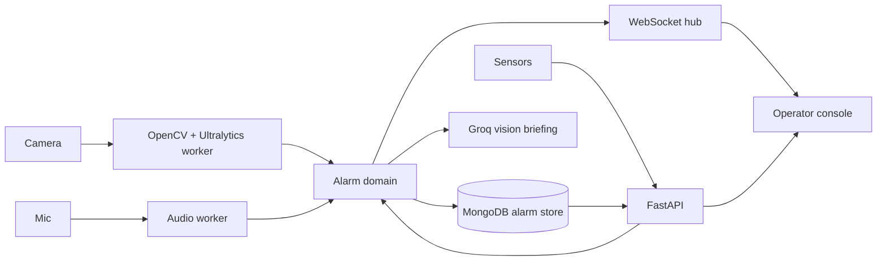

# Patient Watch architecture

## Requirements and assumptions

- One deployment monitors one bed from a local or network camera.
- Calls, vital readings, pose inference, and audio thresholds create durable alarms.
- Operators authenticate, receive live events, and acknowledge alarms.
- Raw video and audio remain local; only alarm metadata is persisted.
- Detection fails visibly. This is an operational aid, not a certified medical device.

## ADR-001: Modular monolith

**Status:** Accepted

**Decision:** Deploy API, inference workers, persistence, and web client together behind separate module boundaries.

**Alternatives:** Microservices add network and operational failure modes without a demonstrated independent scaling need. Browser-only inference cannot provide controlled server-side processing or durable events.

**Consequences:** Installation stays simple and inference can later move behind the callback boundary. The process is currently one failure domain.

## ADR-002: Local inference and metadata-only persistence

**Status:** Accepted

**Decision:** Process media locally, retain only alarm records, and expose the latest annotated frame without recording it.

**Alternatives:** Cloud inference adds privacy exposure, bandwidth use, latency, and outage dependency. Continuous recording requires retention and consent rules that are not defined.

**Consequences:** Patient media is not uploaded or retained. Production still requires disk encryption, TLS, backups, access logging, and calibrated hardware.

Groq is optional and outside the alarm decision path. A current JPEG is sent only when an authenticated operator requests a briefing; its result is observational, non-diagnostic, and cannot create or clear alarms.

## Failure modes

| Failure | Behaviour |
| --- | --- |
| Camera/model unavailable | Worker reports failed and creates a system alarm |
| Microphone unavailable | Audio reports failed; video and API continue |
| Browser disconnects | WebSocket reconnects and history reloads from storage |
| Process/database unavailable | External supervision must restart and alert |

Initial scale is one camera and fewer than ten consoles. MongoDB uses indexes for chronological history and active-alarm queries; Atlas or a replica set should be used for production durability.

